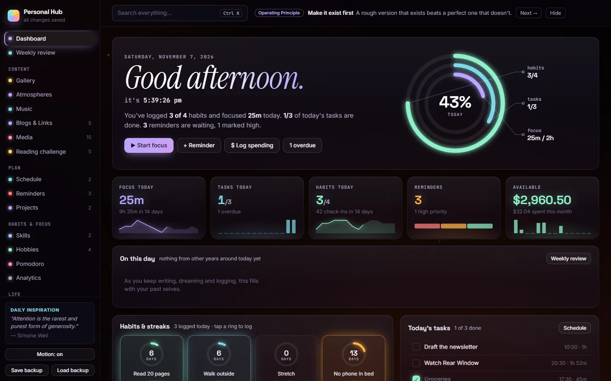
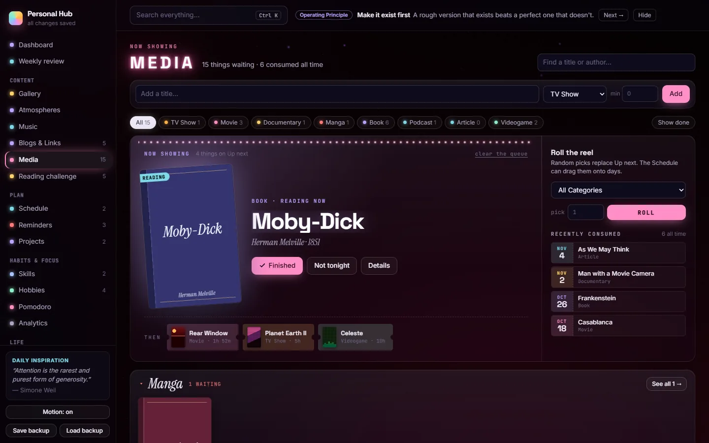
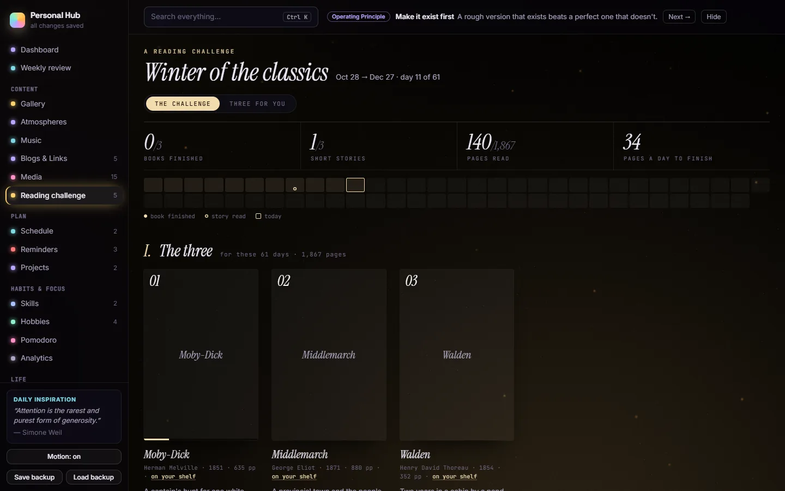
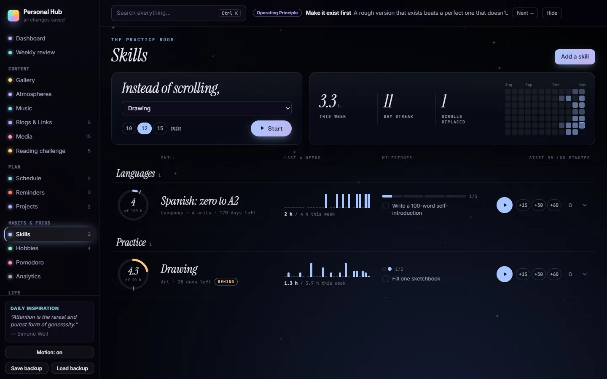
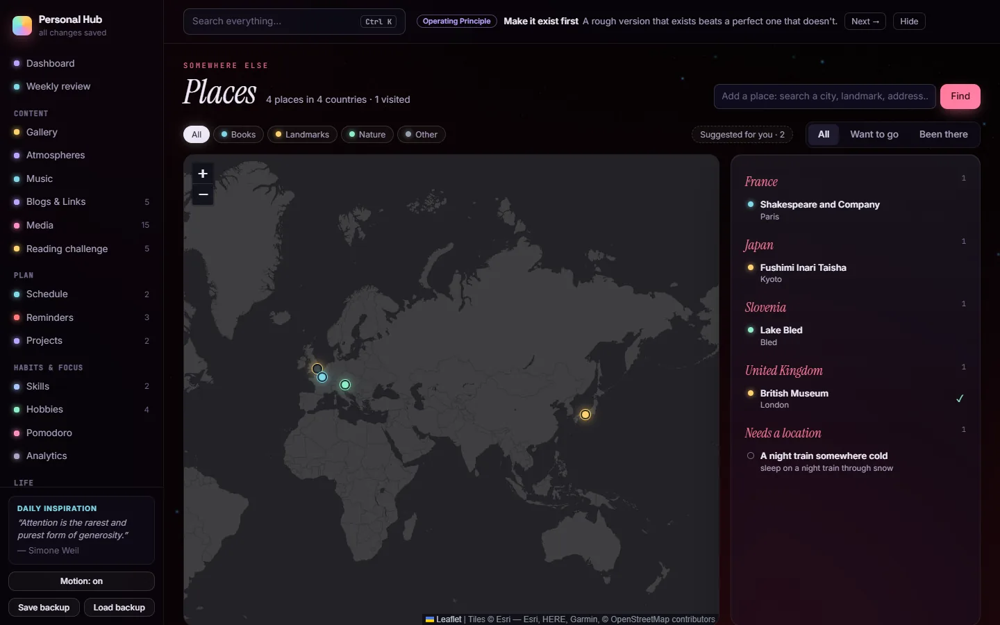

# Personal Hub

A private dashboard for your own life: what you watch and read, the music you keep, the skills you're learning, your
habits, focus, money, notes, dreams, diary and the places you want to go. The point is to **see who you are over
time**, so almost everything is dated and every tab shows change, not just a list.

It runs on your own computer. One tiny Node server serves the page and keeps everything in **one JSON file**. There is
no account, cloud, database, build step or npm install.



| | |
|---|---|
|  |  |
|  |  |

*(All screenshots show the made-up demo data.)*

## Try it

You need [Node.js](https://nodejs.org) 18 or newer.

```bash
git clone <this repo> personal-hub
cd personal-hub
npm run demo      # a fictional person's hub at http://localhost:4401, so you can see every tab filled in
npm start         # your own, empty hub at http://localhost:4400
```

Your data lives in `data/hub.json`, created on the first `npm start`. The demo never touches it.

On Windows:
- `Open Personal Hub.cmd` starts the server in the background (no window) and opens the page.
- `Stop Personal Hub.cmd` stops it.
- To start the hub at login, put a shortcut to `start-hub-hidden.vbs` in your Startup folder (`Win + R`, then
  `shell:startup`).

## What's inside

**Dashboard** and **Weekly review**: today at a glance, "on this day" from past years, and your week against the
twelve before it.

| Content | Plan | Habits & focus | Life & mind |
|---|---|---|---|
| Gallery: a 3D exhibition of your art folders | Schedule: month/week/agenda, drag media onto days | Skills: practice log, target hours, formal courses with syllabus and bibliography | Finance: accounts, spending, bills, wishlist, debts |
| Atmospheres: a mood wall of images/video with a fullscreen "Drift" mode and soundscapes | Reminders (+ optional Windows nudges to go outside, write, review your week) | Hobbies: habits that grow as plants, 66-day habit tracker | Wisdom: principles and quotes, one shown daily |
| Music: your Spotify playlists as genre rooms, a genre map, taste stats, daily listening with scores | Projects: a board with milestones | Pomodoro: focus timer and heatmap | Diary · Dreams (with a "dream atlas" of what recurs) · Notes |
| Blogs & Links: a daily draw of things to read | | Analytics: a productivity score and trends | Places: a world map of where you want to go · Bucket list |
| Media: everything to watch, read and play, with a randomizer and a book shelf | | | |
| Reading challenge: a timed reading plan and a ranked "for you" list | | | |

Search everything with **Ctrl K**. The **Motion** switch turns every animation off. **Save backup** downloads the whole
hub as one file. The server also keeps a daily backup in `data/backups/`.

## Bring your own stuff

The hub starts empty: add things in the page, or import them. Each importer is re-runnable and never duplicates
items. You'll need Python 3.9+ for these.

| From | Command | Goes to |
|---|---|---|
| StoryGraph (CSV export) | `py -3 -I tools/import_storygraph.py export.csv data/hub.json` | Media → Books, with covers from Open Library |
| Spotify (playlist CSVs from [Exportify](https://exportify.net)) | `py -3 -I tools/import_music.py "music folders"` | Music (edit the genre rooms at the top of the script) |
| Obsidian (diary folder) | `py -3 -I tools/import_obsidian_diary.py data/hub.json path/to/folder` | Diary |
| Samsung Notes (Windows app) | `py -3 -I tools/import_samsung_notes.py data/hub.json` | Notes (and a "Dreams" folder → Dreams) |
| A list of places | Fill in `PLACES` at the top of `tools/import_places.py`, then run it | Places, with Wikipedia photos |

On macOS or Linux, use `python3` instead of `py -3`. Stop the server, or work on a copy, while an importer writes to
`data/hub.json`.

For the Gallery and Atmospheres:
- Put art in `images/<artist name>/`.
- Put mood images and videos in `atmospheres/<aesthetic>/<sub-mood>/`.

Both folders stay out of git.

## Make it yours with Claude

This repo includes a [`CLAUDE.md`](CLAUDE.md) that explains every part to [Claude Code](https://claude.com/claude-code):
- how the server and data layer work;
- what each tab does and which data it owns;
- how to add a tab;
- how to change data safely while the hub is running;
- how to test.

Open the folder in Claude Code and ask for what you want, for example:

- "Add a tab for my plants, with watering dates."
- "Read my Media shelf and diary and build me a two-month reading challenge."
- "Import my Goodreads export into Media."
- "Turn my Spanish skill into a formal course with units, milestones and resources."
- "Change the Media categories to add Board games."

[`docs/DATA.md`](docs/DATA.md) documents every key in `hub.json`, for people and for Claude.

## Privacy

Everything stays in `data/` on your machine and is git-ignored, as are `images/`, `atmospheres/` and
`music folders/`. The page only reaches the internet for:
- fonts;
- map tiles, place search and Wikipedia (Places);
- book covers (Open Library);
- the Spotify player (Music).

Nothing is tracked or sent anywhere else.

## Notes

- Built as a web version of an earlier PySide6 desktop app. Comments that mention `*_tab.py` or "the Python app"
  point to where each feature came from; the data format is the same.
- The desktop nudges and the `.cmd` / `.vbs` launchers are Windows-only. Everything else runs anywhere Node does.
- Third-party libraries and recordings: see [THIRD_PARTY.md](THIRD_PARTY.md).

## License

[MIT](LICENSE): use it, change it, share it, as long as the license notice stays with the code. The vendored
libraries and sound recordings keep their own licenses (THIRD_PARTY.md).
